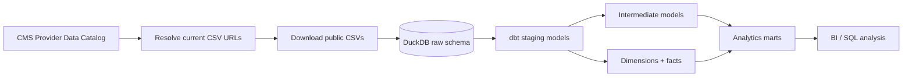
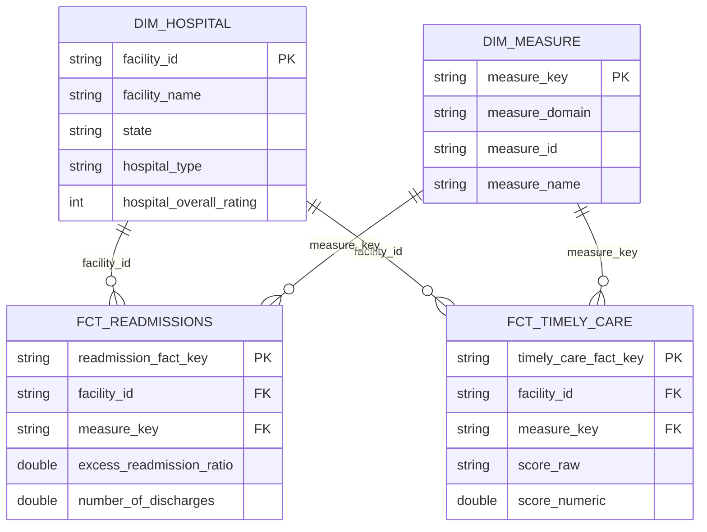

# CMS Hospital Analytics Engineering with dbt

[](https://github.com/Jayanth2429/dbt-analytics-engineering/actions/workflows/ci.yml)

A production-minded **analytics engineering** portfolio project using **real public CMS hospital data**, **dbt**, **DuckDB**, dimensional modeling, automated tests, source lineage, and BI-ready marts.

Unlike a toy seed-only dbt project, the pipeline resolves and downloads the current CMS public CSV resources at runtime, loads a raw warehouse layer, and transforms three related hospital datasets into tested dimensions, facts, and analytical marts.

## Public datasets

The project combines three CMS Provider Data Catalog datasets:

1. **Hospital General Information** (`xubh-q36u`)
2. **Hospital Readmissions Reduction Program** (`9n3s-kdb3`)
3. **Timely and Effective Care - Hospital** (`yv7e-xc69`)

The CMS catalog currently describes these datasets as public and exposes both downloadable CSV resources and programmatic API access. See [`DATA_SOURCES.md`](DATA_SOURCES.md) for source details and caveats.

## Architecture



## Data model



## What this demonstrates

- Metadata-driven ingestion from a real public data catalog
- Raw → staging → intermediate → marts analytics architecture
- dbt `source()` lineage and source freshness metadata
- Dimensional modeling with explicit fact-table grain
- Safe type conversion for messy public CSV fields
- Preservation of leading-zero business identifiers
- Generic dbt tests: uniqueness, not-null, accepted values, relationships
- Singular business-rule tests
- Deterministic surrogate keys
- BI-ready state and hospital marts
- Documentation of data semantics and modeling tradeoffs
- GitHub Actions CI running the complete ingestion + `dbt build`

## Repository structure

```text
.
├── .github/workflows/ci.yml
├── docs/
│   ├── architecture.md
│   └── modeling-decisions.md
├── macros/
│   └── cms_cleaning.sql
├── models/
│   ├── staging/
│   ├── intermediate/
│   └── marts/
│       ├── core/
│       └── analytics/
├── scripts/
│   ├── download_cms_data.py
│   └── load_raw_duckdb.py
├── tests/
├── DATA_SOURCES.md
├── dbt_project.yml
├── profiles.yml
└── requirements.txt
```

## Quick start

### 1. Create the environment

```bash
python3 -m venv .venv
source .venv/bin/activate
python -m pip install --upgrade pip
python -m pip install -r requirements.txt
```

### 2. Download the current public CMS files

```bash
python scripts/download_cms_data.py
```

The downloader uses the stable CMS dataset identifiers and resolves each current CSV URL from CMS metadata. Raw CSV files are ignored by Git.

### 3. Load the raw warehouse layer

```bash
python scripts/load_raw_duckdb.py
```

### 4. Validate dbt connectivity

```bash
dbt debug --profiles-dir .
```

### 5. Build and test the project

```bash
dbt build --profiles-dir .
```

### 6. Generate dbt documentation

```bash
dbt docs generate --profiles-dir .
dbt docs serve --profiles-dir .
```

## Analytical marts

### `mart_hospital_quality_snapshot`
One row per hospital combining general attributes, HRRP measure coverage, excess-readmission-ratio summaries, and Timely and Effective Care coverage.

### `mart_state_hospital_profile`
State-level hospital counts, rating coverage, average reported rating, emergency-services availability, and selected hospital-type counts.

### `mart_readmission_benchmark`
State-by-HRRP-measure benchmark output using CMS-published excess readmission ratios, discharges, and readmission counts.

## Important interpretation notes

This is an engineering and modeling project, not a hospital ranking system. CMS measures have different definitions, reporting periods, eligibility rules, and missing-value conventions. The project preserves those published measures and avoids combining heterogeneous Timely and Effective Care scores into a misleading single quality score.

The HRRP excess readmission ratio is consumed as published by CMS. This repository does not recreate CMS's risk adjustment or infer hospital quality from that measure alone.

## Data privacy

The project uses public CMS provider-level data. It contains no employer data, proprietary schemas, credentials, or patient-level PHI.
