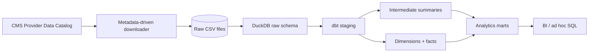

# Architecture

## Layers

### Raw
The Python loader ingests the downloaded CMS CSV files as strings into DuckDB's `raw` schema. A `_loaded_at` timestamp is added at ingestion time.

### Staging
Staging models standardize field names and types, preserve six-character CMS facility IDs as text, convert CMS missing-value labels to null, and safely parse dates and numeric fields.

### Intermediate
Intermediate models perform reusable hospital-level aggregations such as HRRP measure coverage and Timely and Effective Care coverage.

### Core marts
`dim_hospital`, `dim_measure`, `fct_readmissions`, and `fct_timely_care` create explicit dimensional grains suitable for downstream analytics.

### Analytics marts
The final models provide hospital- and state-level views designed for dashboards and exploratory analysis without claiming causal relationships between quality measures.
